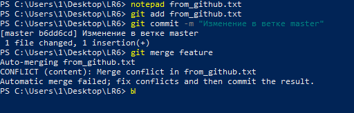
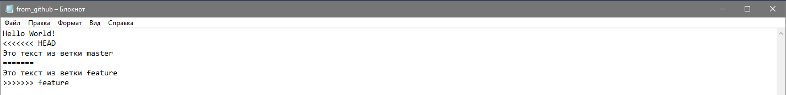

# Лабораторная работа №6

**Выполнил:** Миронов И.С., группа 4516

## Цель работы
Изучение базовых возможностей системы управления версиями, опыт работы с Git Api, опыт работы с локальным и удаленным репозиторием.

## Ход выполнения работы

### 1-5. Подготовка и клонирование
Был сделан форк репозитория, установлен Git, настроены параметры пользователя (user.name, user.email). Репозиторий склонирован на локальный компьютер.

### 6. Добавление файла через GitHub
Файл from_github.txt был создан через веб-интерфейс GitHub и подтянут в локальный репозиторий командой git pull origin master.

### 7-8. История операций и просмотр изменений
Были изучены команды просмотра истории и последних изменений.


### 9-10. Слияние с конфликтом
При слиянии ветки feature в master возник конфликт. Он был разрешен вручную с помощью текстового редактора. Побочная ветка была удалена.




### 11-12. Коммиты и откат
Было сделано несколько коммитов. Затем последний коммит был отменен с сохранением изменений в рабочей директории командой git reset --soft HEAD~1.


### Лог команд

```bash
# Клонирование и настройка
git config --global user.name "4516, Миронов И.С."
git config --global user.email "21.igor.com@gmail.com"
git clone https://github.com/Fr1zz21/LR6.git
cd LR6

# Синхронизация
git pull origin master

# Ветки и конфликты
git checkout -b feature
git add from_github.txt
git commit -m "Изменение текста в ветке feature"
git checkout master
git add from_github.txt
git commit -m "Изменение текста в ветке master"
git merge feature
git add from_github.txt
git commit -m "Разрешен конфликт при слиянии feature в master"
git branch -d feature

# Коммиты и откат
git add file1.txt
git commit -m "Добавлен file1"
git add file2.txt
git commit -m "Добавлен file2"
git reset --soft HEAD~1
git log --oneline
```

### 15. Форматированная история коммитов

```text
63e8f8c 2026-11-01 Миронов И.С. Добавлен file1
2d9c165 2026-11-01 Миронов И.С. Разрешен конфликт при слиянии feature в master
b6dd6cd 2026-11-01 Миронов И.С. Изменение в ветке master
8e653c8 2026-11-01 Миронов И.С. Изменение в ветке feature
315068f 2026-11-01 Миронов И.С. Create from_github.txt
921f53b 2026-11-01 Куртяник Обновление информации
c08a654 2026-11-01 Куртяник Файл создан пустым
3c6e913 2026-11-01 Куртяник Initial commit
```